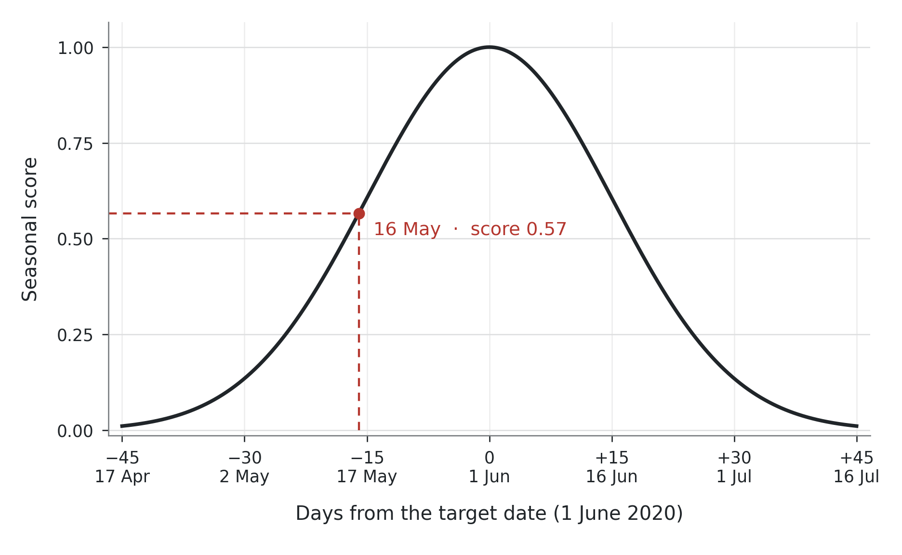

---

## Introduction

**Guiding question:** How can we combine several satellite observations into one image that represents a chosen time of year?

You will use **FORCE BOA/QAI pairs** to create a Best-Available-Pixel (BAP) composite in R with `terra`. Our definition of “best” has two parts: **QAI determines which observations are suitable; temporal suitability determines which suitable observation is selected.** At each location, all ten spectral bands come from the same observation.

### Learning objectives

After this session you should be able to:

- match BOA images and QAI files and interpret relevant quality flags;
- explain the difference between excluding an observation and ranking suitable observations;
- set a target date and time window and create a BAP composite;
- evaluate coverage and pixel origins and make a simple map in QGIS.

::: {.callout-note}
## Preparation

Use R/RStudio, the `terra` package and QGIS. Put the provided files for **one spatial tile** in `data/force` within your RStudio project. Every ENVI `.dat` needs its matching `.hdr` in the same folder; retain any `.aux.xml` files too. The data can be found here: https://box.fu-berlin.de/s/XmmcrkrBPcCkAzs

This week, the R code is provided so you can focus on understanding how observations from several Sentinel-2 images are combined into a single composite.

The three images below show the same area on different dates. Imagine that one location is cloudy on the first date but clear on the other two. Which observation should we use? In this exercise, we use the quality flags to identify suitable observations and then choose the one with the best temporal score. We repeat this for each pixel. Neighbouring pixels can therefore come from different dates, while all ten bands at any one pixel come from the same observation.

.](./images/s04_compositing.png){#fig-bap-compositing width="500px"}

:::

## 1. Opening questions — define “best available”

**Work in smallgroups**, then shortly summarize your explanation. Consult the [HU Berlin BAP tutorial](https://eol.pages.cms.hu-berlin.de/gcg_eo/04_baps.html) and [FORCE QAI documentation](https://force-eo.readthedocs.io/en/latest/howto/qai.html).

- **Question A — Compositing:** Why combine observations? How does selecting one observed spectrum differ from calculating a median separately for each band? Can a composite always fill every gap?
- **Question B — Time:** How would you choose observations for a spring image of one particular year? What changes if observations from neighbouring years are allowed? Which information would you need to check the result?


## 2. Inspect the data and create matching pairs

### Input structure and spectral bands

| Input | Contents |
|:---|:---|
| `20160402_LEVEL2_SEN2A_BOA.dat` + `.hdr` | One acquisition with ten spectral bands |
| `20160402_LEVEL2_SEN2A_QAI.dat` + `.hdr` | Quality information for the same acquisition |
| Further dates with the same structure | Additional candidate observations |

Open the **`.dat`**, rather than the `.hdr`, with `rast()`. The file-selection code also accepts GeoTIFF pairs. The supplied example headers describe a **3000 × 3000** grid at **10 m** spacing and **ETRS89 / LAEA Europe (EPSG:3035)**. Check the metadata of the dataset too.

For the supplied Sentinel-2 BOA files, use this band order:

| Position | Name | Sentinel-2 band |
|---:|:---|:---|
| 1 | BLUE | B02 |
| 2 | GREEN | B03 |
| 3 | RED | B04 |
| 4 | RE1 | B05 |
| 5 | RE2 | B06 |
| 6 | RE3 | B07 |
| 7 | BNIR | B08 |
| 8 | NIR | B8A |
| 9 | SWIR1 | B11 |
| 10 | SWIR2 | B12 |

BOA uses a scale of **10,000** and NoData **−9999** in these files. We divide by 10,000 **once**, on import. A common 10 m grid does not add native 10 m detail to the bands originally acquired at 20 m. See the [FORCE output documentation](https://force-eo.readthedocs.io/en/latest/components/lower-level/level2/format.html).

### Import and subset

The code searches one folder and matches QAI to each BOA by filename. It does not search through directories containing other tiles. Create an RStudio project with a `data/force` folder, then run:

```{r}
# Run once if needed: install.packages("terra")
library(terra)

# Folder containing the FORCE scenes and folder for the results.
# For ENVI data, keep each .dat file together with its .hdr file.
data_dir <- "./data/force"
out_dir  <- "./data/variant_1"
dir.create(out_dir, recursive = TRUE, showWarnings = FALSE)

# 1. Find the BOA images and their matching QAI files ----------------------

# Each acquisition has a BOA image containing surface reflectance and
# a QAI raster containing quality information for the same pixels.
# Start with the BOA files. Their names begin with the acquisition date
# (YYYYMMDD) and end in _BOA.dat, _BOA.tif or _BOA.tiff.
boa_files <- list.files(
  path = data_dir,
  pattern = "^[0-9]{8}_LEVEL2_SEN2[ABC]_BOA\\.(dat|tif|tiff)$",
  full.names = TRUE,
  ignore.case = TRUE
)

# Within each pair, only the product label changes. For example,
# 20160502_LEVEL2_SEN2A_BOA.dat pairs with 20160502_LEVEL2_SEN2A_QAI.dat.
qai_files <- sub("_BOA\\.", "_QAI.", boa_files, ignore.case = TRUE)

if (!all(file.exists(qai_files))) {
  stop("A matching QAI file is missing. Check the files in ", data_dir)
}

# 2. Create a table with one row per acquisition --------------------------

# basename() removes the folder path so that the first eight characters
# are the date. For example, as.Date() converts "20160502" to 2016-05-02.
date_text <- substr(basename(boa_files), 1, 8)
inputs <- data.frame(
  date = as.Date(date_text, format = "%Y%m%d"),
  boa  = boa_files,
  qai  = qai_files
)

# Sort the acquisitions from earliest to latest, then give each one an ID.
# Later, this ID tells us which acquisition supplied a composite pixel.
inputs <- inputs[order(inputs$date), ]
inputs$source_id <- seq_len(nrow(inputs))

# Display the IDs and dates. The file paths remain in the table.
inputs[, c("source_id", "date")]

# 3. Open the first BOA image and inspect its bands ------------------------

# The first image provides the extent and coordinate system for our
# example area. Print the raster to see its resolution, CRS and layers.
template <- rast(inputs$boa[5])
template

# These names follow the band order in the supplied FORCE BOA images.
# Assigning names labels the layers and preserves their original order.
band_names <- c("BLUE", "GREEN", "RED", "RE1", "RE2", "RE3",
                "BNIR", "NIR", "SWIR1", "SWIR2")
names(template) <- band_names

# 4. Select a 6 × 6 km area and display it in true colour -----------------

# Find the centre of the image in its projected coordinate system (metres).
cx <- (xmin(template) + xmax(template)) / 2
cy <- (ymin(template) + ymax(template)) / 2

# Extend 3,000 m from the centre in each direction.
# ext() expects the boundaries in the order xmin, xmax, ymin, ymax.
aoi <- ext(cx - 3000, cx + 3000, cy - 3000, cy + 3000)
example <- crop(template, aoi)

# Replace the FORCE NoData value with NA before scaling the reflectance.
# A stored value of 2500, for example, corresponds to a reflectance of 0.25.
example <- ifel(example == -9999, NA, example)
example <- example / 10000

# Display red (layer 3), green (layer 2) and blue (layer 1).
# The linear stretch adjusts the contrast for display only.
plotRGB(example, r = 3, g = 2, b = 1, stretch = "lin")
```

**Checkpoint:** Which date does `source_id = 1` represent? Why must the BOA and QAI grids agree? Replace the example AOI only after confirming your coordinates and CRS.

## 3. Use QAI to screen observations

### Decode relevant fields

QAI combines several fields in one integer. Bit numbering starts at **0**. Extract a field with `floor(q / 2^start) %% 2^width`; this works for numbers and `SpatRaster` objects.

| Bits | Field | Meaning used here |
|:---|:---|:---|
| 0 | NoData | 0 observed; 1 missing |
| 1–2 | Cloud | 0 clear; 1 buffer/uncertain; 2 opaque; 3 cirrus |
| 3 / 4 / 5 | Shadow / snow / water | 1 indicates the respective condition |
| 6–7 | Aerosol | 0 estimated; 1 interpolated; 2 high; 3 fallback |
| 8 / 9 / 10 | Subzero / saturation / low sun | 1 indicates a flagged condition |
| 11–12 | Illumination | 0 good; 1 medium; 2 poor; 3 shadow |
| 13 | Topographic correction | 1 indicates enhanced C-correction |
| 14 | Water vapour | 1 indicates scene-average fallback |

**Question:** How does QAI differ from SCL of Sentinel-2? Decode **4, 64, 8192 and 8194**. Does every nonzero QAI value mean an unusable observation?

Consult the [full definitions](https://force-eo.readthedocs.io/en/latest/howto/qai.html). The following example helps distinguish a packed QAI integer from the value of one decoded field:

```{r}
# A single QAI value stores several quality flags as bits in one integer.
# This function extracts the value of one field, such as cloud or aerosol.
#   q     = one QAI value or a vector of QAI values
#   start = position of the field's first bit, counting from 0 on the right
#   width = number of bits in the field (1 bit by default)
qai_field <- function(q, start, width = 1L) {
  # Divide by 2^start and round down to discard the bits to the right.
  # Then take the remainder modulo 2^width to keep only the selected bits.
  floor(q / 2^start) %% 2^width
}

# Try the function on five example QAI values.
q <- c(0, 4, 64, 8192, 8194)

# Each row shows the original QAI value and three decoded fields.
# A two-bit field can hold four codes (0 to 3). A one-bit flag is 0 or 1.
data.frame(
  QAI     = q,
  cloud   = qai_field(q, 1, 2),  # Read bits 1 and 2
  aerosol = qai_field(q, 6, 2),  # Read bits 6 and 7
  slope   = qai_field(q, 13)     # Read bit 13 (default width = 1)
)
```

### Choose and inspect the mask

Our starting rules exclude missing data, all flagged cloud states **including the existing cloud buffer**, shadows, snow, aerosol states 2–3, subzero/saturation flags, low sun and poor/shadowed illumination. Water, interpolated aerosols, the correction flag and water-vapour fallback are retained. These choices describe this exercise; they are not universal rules for every application.

```{r}
# Build a quality mask from the QAI raster for one acquisition.
# The output has two values: 1 = keep the pixel, 0 = exclude it.
quality_mask <- function(q, strict = FALSE) {

  # The strict option changes two criteria: aerosol and terrain illumination.
  # By default, we accept codes 0 and 1 for both. In strict mode, we
  # accept only code 0. All other criteria are the same in both modes.
  max_code <- if (strict) 0 else 1

  # Read one QAI field at a time. The & operator means that a pixel
  # must meet every condition below to be kept.
  good <- q >= 0 &                              # Exclude negative fill values
    qai_field(q, 0) == 0 &                      # Pixel is marked as valid
    qai_field(q, 1, 2) == 0 &                   # Cloud state is clear
    qai_field(q, 3) == 0 &                      # No cloud shadow
    qai_field(q, 4) == 0 &                      # No snow
    qai_field(q, 6, 2) <= max_code &            # Aerosol: 0 estimated, 1 interpolated
    qai_field(q, 8) == 0 &                      # No band has negative reflectance
    qai_field(q, 9) == 0 &                      # No saturation flag
    qai_field(q, 10) == 0 &                     # Sun elevation is at least 15 degrees
    qai_field(q, 11, 2) <= max_code             # Illumination: 0 good, 1 medium

  # Water (bit 5) can be kept if the pixel meets the criteria above.
  # A missing QAI value gives us no quality information, so assign it 0.
  ifel(is.na(good), 0, good)
}

# Open the QAI raster for the same acquisition as the BOA example.
# Crop it to the same area so that the two rasters cover the same pixels.
qai_example <- crop(rast(inputs$qai[5]), aoi)

# Apply the default criteria. To use the stricter aerosol and illumination
# criteria, call quality_mask(qai_example, strict = TRUE).
good_example <- quality_mask(qai_example)

# 1. Inspect the cloud field on its own.
#    0 = clear, 1 = less confident cloud (cloud buffer),
#    2 = opaque cloud, 3 = cirrus.
plot(qai_field(qai_example, 1, 2), main = "Decoded cloud state (0–3)")

# 2. Inspect the combined mask. Look for pixels that were classified
#    as clear in the first map but are excluded by another criterion.
plot(good_example, main = "Quality mask: 1 = keep, 0 = exclude")

# 3. Apply the mask to all reflectance bands. Wherever the mask is 0,
#    mask() sets the corresponding BOA pixel to NA in every band.
masked_example <- mask(example, good_example, maskvalues = 0)

# Display the remaining pixels in true colour.
plotRGB(masked_example, r = 3, g = 2, b = 1, stretch = "lin")
```

We check both missing values and **bit 0**, because NoData metadata may differ between header and auxiliary files. QAI is never divided by 10,000.

**Checkpoint:** Identify one retained and one rejected location and explain the relevant flags. Compare them with the RGB image. Why might bright urban surfaces require closer inspection?

## 4. Define temporal suitability

We create a **2020** composite centred on **1 June**, initially allowing observations up to **45 days** away from that seasonal target and only from the **target year only**. 

For eligible candidates we use a seasonal score and, optionally, a year score:

$$
S_d=\exp\left[-\frac12\left(\frac{\Delta d}{\sigma_d}\right)^2\right],
\qquad S_y=1-\frac{\Delta y}{Y+1},
\qquad S=w_dS_d+w_yS_y.
$$

Here $\Delta d$ is seasonal distance in days, $\Delta y$ is the absolute year difference, $Y$ is the permitted year offset and $w_d+w_y=1$. We exclude observations outside the chosen windows **before selection**. In the one-year example, year suitability is constant, so its weight is zero.

The target date is 1 June 2020. The 45-day window on either side includes acquisitions from 17 April to 16 July. Within this window, dates closer to 1 June receive a higher score. For example, 16 May is 16 days before the target. With `sigma_days = 15`, its seasonal score is 0.57.

{#fig-seasonal-score width="700px"}

```{r}
# 1. Set the target date and choose the temporal criteria -----------------

# We want the composite to represent conditions around 1 June 2020.
# Use a month and day that exist in every year covered by the data.
target_date <- as.Date("2020-06-01")

# How far from the target day can an acquisition be and still be used?
# In 2020, this window runs from 17 March to 15 June, inclusive.
max_season_days <- 45

# How strongly should we favour acquisitions close to the target day?
# With sigma = 15, the seasonal score is about 0.61 at a distance of
# 15 days and 0.14 at a distance of 30 days.
sigma_days <- 15

# Which calendar years can contribute? With 0, only 2020 is eligible.
# A value of 1 would also allow acquisitions from 2019 and 2021.
max_year_offset <- 0L

# How much should each criterion contribute to the final score?
# Here, seasonal proximity receives the full weight.
weights <- c(season = 1, year = 0)

# Use the default pixel quality criteria when applying the QAI mask later.
strict_qai <- FALSE


# 2. Calculate temporal distances and scores ------------------------------

temporal_scores <- function(dates, target_date, max_season_days,
                            sigma_days, max_year_offset) {

  # Extract the year of each acquisition and the year of the target date.
  years <- as.integer(format(dates, "%Y"))
  target_year <- as.integer(format(target_date, "%Y"))

  # To measure seasonal proximity, place the target month and day in each
  # acquisition's own year. For example, compare 10 May 2019 with 1 May
  # 2019: the seasonal distance is 9 days and the year offset is 1.
  target_month_day <- format(target_date, "%m-%d")
  anchors <- as.Date(paste(years, target_month_day, sep = "-"))

  # A calendar year has either 365 or 366 days. Subtracting consecutive
  # New Year's Days gives the correct length for each acquisition year.
  year_start <- as.Date(paste0(years, "-01-01"))
  next_year_start <- as.Date(paste0(years + 1L, "-01-01"))
  year_length <- as.numeric(next_year_start - year_start)

  # Count days in both directions around the calendar and take the shorter
  # distance. This also works for winter targets: 31 Dec is 1 day from 1 Jan.
  delta <- abs(as.numeric(dates - anchors))
  season_days <- pmin(delta, year_length - delta)

  # Count the difference in calendar years, regardless of direction.
  year_offset <- abs(years - target_year)

  # An acquisition must meet BOTH limits to be eligible for the composite.
  allowed <- season_days <= max_season_days & year_offset <= max_year_offset

  # The seasonal score is 1 on the target day. It decreases symmetrically,
  # so 15 days before and 15 days after the target receive the same score.
  season_score <- exp(-0.5 * (season_days / sigma_days)^2)

  # The target year scores 1. If we allow one neighbouring year on either
  # side (max_year_offset = 1), each of those years scores 0.5.
  year_score <- pmax(0, 1 - year_offset / (max_year_offset + 1))

  # Return one row per acquisition, in the same order as the input dates.
  data.frame(season_days, year_offset, allowed, season_score, year_score)
}


# 3. Apply the settings to our acquisitions -------------------------------

timing <- temporal_scores(inputs$date, target_date, max_season_days,
                          sigma_days, max_year_offset)

# Stop if the selected dates leave us with no scenes for the composite.
if (!any(timing$allowed)) {
  stop("No acquisitions fall within the selected year and seasonal windows.")
}

# Combine the seasonal and year scores. With weights of 1 and 0,
# the final score equals the seasonal score.
timing$score <- weights["season"] * timing$season_score +
                weights["year"]   * timing$year_score

# Inspect all acquisitions. First, use 'allowed' to identify the eligible
# dates. Then compare their scores: which date would be preferred if
# the pixel passed the QAI mask in every eligible scene?
print(cbind(inputs[, c("source_id", "date")], timing))
```

For the defaults, seasonal scores are about **0.154** on 2 April and **0.998** on 2 May. Predict which date should win where both pass the quality mask.

::: {.callout-note}
## What changes the result?

With one year and only a seasonal score, selecting the highest score is equivalent to selecting the suitable date **closest to the target**. Changing `sigma_days` alone changes score values but not their ranking. To obtain a different composite, change the target, the permitted window or the quality rules.

Suppose your target date is 1 January 2020. An image from 31 December 2019 is only one day away, but max_year_offset <- 0 allows only images from 2020. Set max_year_offset <- 1 to include 2019 and 2021 as well. Pixels in your composite may then come from different years. For example, weights <- c(season = 0.7, year = 0.3) gives 70% of the score to how closely an image matches the target time of year and 30% to how close its year is to the target year.
:::

## 5. Score candidates and select one complete spectrum

The following loop imports each pair, checks the grid and combines three requirements: the QAI rules, values in all ten spectral bands and the allowed temporal window. Among suitable observations, the score depends only on date.

```{r}
# Prepare one list entry per acquisition. The same index i refers to
# the same acquisition in all three lists.
n_obs <- nrow(inputs)
boa             <- vector("list", n_obs)  # Reflectance in all ten bands
eligible_layers <- vector("list", n_obs)  # Which pixels can be used?
score_layers    <- vector("list", n_obs)  # What score do those pixels receive?

for (i in seq_len(n_obs)) {
  message("Preparing ", format(inputs$date[i]))

  # Open the reflectance image and its matching quality raster.
  # Crop both to the same study area.
  b <- crop(rast(inputs$boa[i]), aoi)
  q <- crop(rast(inputs$qai[i]), aoi)

  # Replace missing reflectance values with NA, then apply the scale factor.
  b <- ifel(b == -9999, NA, b) / 10000
  names(b) <- band_names

  # At each pixel, count how many bands contain a value.
  # We need all ten because the composite takes all bands from one acquisition.
  n_valid_bands <- app(!is.na(b), "sum")
  complete_spectrum <- n_valid_bands == nlyr(b)

  # The date check applies to the whole acquisition.
  # The quality and band checks can give different results at each pixel.
  good_quality <- quality_mask(q, strict = strict_qai)
  eligible <- good_quality & complete_spectrum & timing$allowed[i]

  # Keep the reflectance image for the later compositing step.
  boa[[i]] <- b
  eligible_layers[[i]] <- eligible

  # Every eligible pixel receives the temporal score of this acquisition.
  # An excluded pixel receives NA so it cannot be selected later.
  score_layers[[i]] <- ifel(eligible, timing$score[i], NA)
}

# Stack the score maps. Each layer represents one acquisition.
# Its name links it to the source_id in the inputs table.
scores <- rast(score_layers)
names(scores) <- paste0("obs_", inputs$source_id)

# Count the eligible acquisitions at each pixel.
# Each TRUE contributes 1 and each FALSE contributes 0.
n_eligible <- app(rast(eligible_layers), "sum")
names(n_eligible) <- "eligible_observations"

# A value of 0 means the composite will have a gap here.
# A value of 1 means only one acquisition can supply this pixel.
# A value of 2 or more means there are several candidates to choose from.
plot(n_eligible, main = "Number of eligible observations per pixel")
```

If no acquisition can be used for a pixel, its value stays NA. If several acquisitions share the highest score, the code chooses the earliest date. If they also have the same date, it chooses the first filename in alphabetical order.

```{r}
# 1. Choose one acquisition for each pixel --------------------------------

# Each layer in 'scores' represents one acquisition, in the same order
# as the rows in 'inputs'. Excluded pixels have a score of NA.
best_score <- max(scores, na.rm = TRUE)

# Find the acquisitions that reach the highest score at each pixel.
# If several acquisitions tie, which.lyr() selects the first one.
is_best <- scores == best_score
source_index <- which.lyr(is_best)

# Where no acquisition was eligible, leave the source ID missing.
source_index <- ifel(n_eligible == 0, NA, source_index)
names(source_index) <- "source_id"


# 2. Build the best available pixel (BAP) composite -----------------------

bap_bands <- list()

for (band in band_names) {

  # Collect this band from every acquisition, keeping the original order.
  # For example, when band is "RED", this stack contains one red layer
  # per acquisition.
  band_time_series <- rast(lapply(boa, function(scene) scene[[band]]))

  # Read the value from the selected acquisition at each pixel.
  # If source_index is 2, take the value from layer 2 of this stack.
  # We use the same source_index for every band, so the spectrum at
  # each pixel comes from a single acquisition.
  bap_bands[[band]] <- selectRange(band_time_series, source_index)
}

# Combine the selected bands into one multispectral image.
bap <- rast(bap_bands)
names(bap) <- band_names


# 3. Record where each composite pixel came from --------------------------

# Use the source ID to look up the acquisition date in 'inputs'.
# Store the date in three forms, e.g. 20200501, day 122, and year 2020.
ids <- inputs$source_id
dates <- inputs$date

date_map <- subst(source_index, ids, as.integer(format(dates, "%Y%m%d")))
doy_map  <- subst(source_index, ids, as.integer(format(dates, "%j")))
year_map <- subst(source_index, ids, as.integer(format(dates, "%Y")))

# Keep the score of the selected acquisition and the number of candidates.
# For example, a pixel can have a high score even if only one date was usable.
selected_score <- selectRange(scores, source_index)
info <- c(source_index, date_map, doy_map, year_map, selected_score, n_eligible)
names(info) <- c("source_id", "date_YYYYMMDD", "DOY", "year",
                 "score", "eligible_observations")


# 4. Compare the composite with the source map ----------------------------

# The RGB image shows what the landscape looks like.
plotRGB(bap, r = 3, g = 2, b = 1, stretch = "lin")

# The source map shows which acquisition supplied each pixel.
# Use the source ID to find its date in the inputs table.
plot(info[["source_id"]], main = "Selected acquisition (source ID)")
```

**Checkpoint:** Why do we use one source index for every band? Where no candidate passes, the source and BOA output stay `NA`, and `eligible_observations` is **0**. BAP cannot guarantee complete coverage. The count includes the quality rules, spectral completeness and temporal windows.

## 6. Evaluate and export

Use common display limits when comparing source images and the composite. Separate histogram stretches can hide or exaggerate differences.

```{r}
# 1. Compare the input images with the composite --------------------------

rgb_view <- function(x, title) {

  # Select the three bands in RGB order.
  rgb <- x[[c("RED", "GREEN", "BLUE")]]

  # Use the same display range for every image. In each colour channel,
  # reflectance of 0 appears black and 0.30 gives full brightness.
  # Values above 0.30 are shown at full brightness. This only affects the plot.
  rgb <- clamp(rgb, 0, 0.30, values = TRUE)
  rgb <- rgb / 0.30 * 255

  plotRGB(rgb, r = 1, g = 2, b = 3, scale = 255,
          axes = TRUE, mar = c(2, 3, 3, 1), main = title)
}

# The inputs are sorted by date. Show the earliest and latest input images,
# then the composite. The input dates may fall outside the selected window.
last <- nrow(inputs)
rgb_view(boa[[1]],    paste("First input:", inputs$date[1]))
rgb_view(boa[[last]], paste("Last input:", inputs$date[last]))
rgb_view(bap,         "Best available pixel composite")


# 2. How much of the study area is covered? -------------------------------

# A pixel has a source ID if at least one acquisition could be used there.
# The mean of this TRUE/FALSE map is the fraction of pixels covered.
covered <- !is.na(source_index)
coverage_percent <- 100 * global(covered, "mean")[1, 1]
round(coverage_percent, 1)

# Which acquisitions supplied those pixels?
# 'value' is the source ID and 'count' is the number of pixels it supplied.
# Look up the source ID in 'inputs' to find the acquisition date.
freq(source_index, bylayer = FALSE)


# 3. Save the composite and its information layers ------------------------

# Use the target date in all filenames, e.g. BAP_20200501_reflectance.tif.
tag <- format(target_date, "%Y%m%d")
prefix <- file.path(out_dir, paste0("BAP_", tag))

bap_path  <- paste0(prefix, "_reflectance.tif")
info_path <- paste0(prefix, "_information.tif")

# Save all ten reflectance bands. The RGB display limits do not affect them.
writeRaster(bap, bap_path, overwrite = TRUE,
            datatype = "FLT4S", gdal = "COMPRESS=DEFLATE")

# Save the source ID, date, day of year, year, score and observation count.
# Use 64-bit precision so dates such as 20200501 are stored exactly
# alongside scores with decimal places.
writeRaster(info, info_path, overwrite = TRUE,
            datatype = "FLT8S", gdal = "COMPRESS=DEFLATE")


# 4. Save the input table and settings ------------------------------------

# One row per acquisition: source ID, date, filenames and temporal scores.
# This table links the source IDs in the map to the original images.
source_table <- cbind(inputs, timing)
source_table$boa <- basename(source_table$boa)
source_table$qai <- basename(source_table$qai)

write.csv(source_table, paste0(prefix, "_sources.csv"), row.names = FALSE)

# Record the settings so you can see how this composite was made.
settings <- list(
  target_date = target_date,
  max_season_days = max_season_days,
  sigma_days = sigma_days,
  max_year_offset = max_year_offset,
  weights = weights,
  strict_qai = strict_qai,
  aoi = as.vector(aoi),
  bands = band_names,
  reflectance_divisor = 10000,
  selection = "QAI screen and complete spectrum, then highest eligible temporal score",
  ties = "first in date/filename order"
)

dput(settings, file = paste0(prefix, "_settings.txt"))

```

## 7. Inspect in QGIS and make one map

1. Add the exported reflectance and information GeoTIFFs. Use **Multiband color** with **3/2/1** for true colour or **7/3/2** for vegetation false colour.
2. Display the `source_id` band of the information raster with **Paletted/Unique values** and match its values to the sources CSV. Inspect the `eligible_observations` band separately too.
3. Use **Identify Features** at two locations to check source date and observation count. Explain a location with one suitable candidate and, if present, one with none.
4. Make **one simple map** of the composite: a clear title, scale bar and a short note identifying the data and target period are sufficient.

## 8. Homework — Compare two choices

1. **Define and document** the AOI, target date, allowed period and quality rules. Create a BAP with the supplied collection.
2. **Create a second variant** by changing one meaningful decision: the target date, time window or quality rules (`strict_qai <- TRUE`). For the supplied April/May example, try **10 April** as an alternative target. Keep the AOI fixed and use a different `out_dir`, such as `output/variant_2`, to retain both results.
3. **Compare** coverage, source-date contributions and two example pixel selections. Show a source-ID or observation-count visualization and explain any gaps or visible seams.
4. **Map and discuss:** make one simple QGIS map of your variant and justify your choice. Explain one remaining limitations, including possible phenological differences between selected dates.

**Submit via Moodle:** Your answers for Question A and B, your structured R-code, the source/parameter records, the map, one diagnostic visualization and the short comparison. Include raster outputs. Label your pair and variants clearly.

## 9. Function reference

Use the R help when an argument is unfamiliar, for example `?terra::mask`.

| Functions | Role today |
|:---|:---|
| `list.files()`, `sub()`, `as.Date()` | Find matching files and extract acquisition dates |
| `rast()`, `names()`, `nlyr()` | Import and inspect raster layers |
| `compareGeom()`, `ext()`, `crop()` | Check grids and select a small study area |
| `ifel()`, `mask()` | Translate quality rules into exclusions |
| `app()`, `selectRange()` | Find the winning observation and select its values |
| `plotRGB()`, `plot()`, `freq()`, `global()` | Inspect images, source IDs and coverage |
| `writeRaster()`, `write.csv()` | Save results and their processing records |

::: {.callout-tip}
## Documentation, debugging and generative AI

You may use documentation, peers and AI tools for support. Test changes on the small AOI. If import fails, check paired filenames and headers; if geometry checks fail, confirm one common tile/grid; if no pixel remains, inspect the quality and time-window exclusions.
:::

## References

- [HU Berlin — Best-Available-Pixel compositing](https://eol.pages.cms.hu-berlin.de/gcg_eo/04_baps.html): conceptual reference. This exercise uses QAI screening followed by temporal ranking.
- [FORCE — Level-2 output format](https://force-eo.readthedocs.io/en/latest/components/lower-level/level2/format.html) and [Quality Assurance Information](https://force-eo.readthedocs.io/en/latest/howto/qai.html): products, scaling and bit fields.
- [FORCE v2 user guide](https://www.uni-trier.de/fileadmin/fb6/prof/FER/Downloads/Software/FORCE/FORCE-user-guide-v-2-0.pdf): historical reference for the supplied FORCE 2.1 examples.
- [`terra::app()`](https://rspatial.github.io/terra/reference/app.html) and [`terra::selectRange()`](https://rspatial.github.io/terra/reference/selectRange.html): raster operations used for selection.
